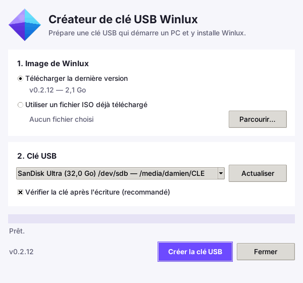

# Créateur de clé USB Winlux

Ce dossier contient un petit logiciel qui prépare une **clé USB d'installation
de Winlux**. On branche ensuite cette clé sur n'importe quel PC, on démarre
dessus, et on installe Winlux définitivement sur le disque du PC.

## Où le trouver

Il n'y a pas de gros fichier dans le dépôt : les deux programmes sont fabriqués
automatiquement par GitHub à chaque version et publiés sur la page
[Releases](https://github.com/Univers4craft/winlux/releases), à côté de l'ISO :

| Fichier | Pour qui |
|---|---|
| `winlux-usb-creator-<version>.exe` | un PC sous **Windows** (double-clic, Windows demande l'autorisation administrateur) |
| `winlux-usb-creator_<version>_all.deb` | **Winlux**, Ubuntu, Debian, Linux Mint… (double-clic sur le paquet, ou `sudo apt install ./winlux-usb-creator_*.deb`) |

Les mêmes fichiers sont aussi disponibles pour chaque modification du code,
dans l'onglet *Actions* de GitHub, tâche « Créateur de clé USB ».

## Comment ça marche

1. **Image de Winlux** : laissez « Télécharger la dernière version » (l'outil
   récupère l'ISO publiée sur GitHub, reprend un téléchargement interrompu et
   contrôle sa somme SHA-256), ou choisissez une ISO déjà téléchargée.
2. **Clé USB** : seules les clés USB et cartes SD sont proposées. Le disque du
   PC, le système en cours et la clé qui contient l'ISO ne le sont jamais.
3. **Créer la clé USB** : une fenêtre rouge rappelle le nom et la taille de la
   clé qui va être effacée ; rien n'est touché avant de cliquer sur « Effacer
   et créer la clé ». Une barre de progression suit l'écriture puis la
   vérification (la clé est relue et comparée à l'image).

Il faut une clé de **4 Go ou plus**. Tout son contenu est effacé.

## Installer Winlux avec la clé

1. Branchez la clé sur le PC et allumez-le.
2. Ouvrez le menu de démarrage (souvent **F12**, **F11**, **F8** ou **Échap**
   au démarrage) et choisissez la clé USB. Elle démarre en UEFI comme en BIOS
   ancien. Si le PC refuse la clé, désactivez le « Secure Boot » dans ses
   réglages de démarrage (voir `docs/SECURE-BOOT.md`).
3. Dans le menu Winlux, choisissez **« Installer Winlux sur le disque »**,
   ou essayez d'abord Winlux sans rien installer avec « Winlux Desktop ».

L'installateur est celui de Winlux (`scripts/winlux-installer.py`). Il ne
propose jamais comme destination la clé dont le PC a démarré.

## Pour les développeurs

- Code : `winlux_usb/` (Python 3.8+, interface Tk, aucune dépendance externe).
  Sous Windows, les disques sont lus et écrits par les API Win32
  (`\\.\PhysicalDriveN`, volumes verrouillés et démontés, écriture sans
  cache) ; sous Linux par `/sys` et le périphérique bloc ouvert en exclusif.
- L'ISO de Winlux est une image hybride (GRUB, UEFI + BIOS) : l'outil la copie
  octet pour octet, sans la modifier.
- Lancer depuis les sources : `python3 installation/winlux-usb-creator.py`.
  En ligne de commande : `list`, `check`, `download`, `write` (voir `--help`).
- Tests : `python3 installation/tests/test_winlux_usb.py` (sans droits) et
  `sudo installation/tests/test-block-device.sh` (écrit sur une fausse clé
  loop, puis démarre une ISO hybride depuis une clé USB simulée par QEMU, en
  BIOS et en UEFI).
- Construction : `installation/packaging/build-deb.sh` pour le `.deb` ;
  l'`.exe` est fabriqué par PyInstaller sur un PC Windows de GitHub Actions
  (`.github/workflows/installation.yml`), qui y teste aussi l'écriture sur un
  disque virtuel VHD.
